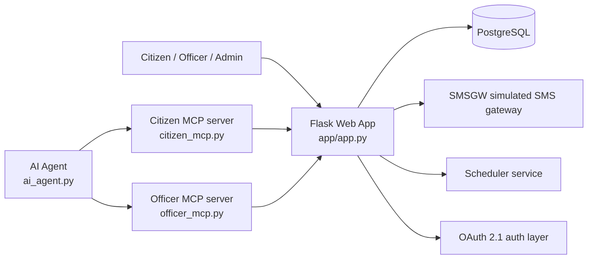

# Sewa Setu Architecture

Sewa Setu is a government pension portal built around a Flask web application, a PostgreSQL database, and a small set of supporting services for SMS, cron jobs, and AI-assisted MCP integrations. The project is designed to support two main user journeys:

- Citizens submit and track old-age pension applications.
- Department staff review applications and approve or reject them.
- External applications can also act on behalf of citizens or officers through OAuth 2.1 flows.

## High-level architecture

## Runtime components

### 1. Flask portal application
The main application lives in `app/app.py` and is the central web backend. It handles:

- citizen signup and OTP-based login
- application form submission
- document upload validation
- status portal access
- admin dashboard operations
- approval/rejection workflows
- OAuth authorization server endpoints
- audit logging and application lifecycle management

This is the business logic and user-facing layer of the system.

### 2. PostgreSQL database
The production database is managed by the `db` service in `docker-compose.yml` and is initialized by `app/schema.sql`. The seed data is loaded from `seed/seed.sql` during first boot.

The app uses PostgreSQL for persistent state such as:

- applications and their statuses
- OTPs and portal login credentials
- OAuth clients, authorization requests, codes, and refresh tokens
- program tokens used for unattended service access
- audit history for each application decision

### 3. Local SQLite compatibility layer
For local development, `app/db_local.py` wraps SQLite and mimics the `psycopg2`-style cursor semantics expected by the application. This makes it possible to run the app without PostgreSQL while preserving most of the application logic.

The app switches behavior using `SEWASETU_LOCAL`.

### 4. Scheduler job
The `scheduler` container runs a nightly job to process deemed approvals. This keeps the pension workflow compliant with the scheme SLA and automatically marks older pending applications as approved if they remain pending beyond the configured deadline.

### 5. SMS gateway
The `smsgw` service simulates telecom delivery. Instead of sending real SMS, it stores message events internally and exposes a local gateway interface. The portal calls into this service for OTP delivery and status notifications.

### 6. AI and MCP services
The project also includes agent-based assistants:

- `ai_agent.py` is a FastAPI + LangGraph orchestrator.
- `citizen_mcp.py` exposes citizen tools such as OTP generation, OTP verification, application submission, and status lookup.
- `officer_mcp.py` exposes officer-only tools to list pending queues and submit decisions.

These services sit above the main portal and allow an LLM-based assistant to act safely within constrained tool boundaries.

## Application flow

### Citizen application lifecycle
1. A citizen starts an application from the web portal.
2. The app sends an OTP to the citizen's mobile number.
3. The citizen verifies the OTP and creates a portal session.
4. The citizen fills in personal details, address, bank information, and uploads age-proof documents.
5. `validate_application()` checks business rules before the record can be created.
6. A new row is inserted into `applications` and the status portal credential is created if missing.
7. The citizen can later check status through the status portal.
8. An officer reviews the application and approves or rejects it.
9. The system logs every action to `audit_log`.

### Admin and officer workflow
Department users log in through the admin portal and can:

- view the application queue
- filter by status or block
- inspect application details
- approve or reject pending cases
- review the audit trail for each application

### OAuth 2.1 flow
The portal also acts as an OAuth authorization server for third-party integrations. This allows an external app to act on behalf of a citizen or officer after consent is granted.

Key OAuth components include:

- `oauth_clients`: trusted external client registrations
- `oauth_requests`: pending authorization requests
- `oauth_codes`: authorization-code exchange data
- `oauth_refresh_tokens`: sign-in session tokens and refresh state
- `oauth_program_tokens`: long-lived service tokens for unattended access

## Database design

The central database model is defined in `app/schema.sql`.

### Core tables

#### `applications`
Stores the pension application itself.

Important fields:

- `id`: primary key
- `application_no`: generated application number
- `applicant_name`, `mobile`, `dob`: applicant identity data
- `village`, `block`: geospatial and scheme assignment data
- `bank_account`, `ifsc`: payment details
- `doc_path`: uploaded age-proof file path
- `status`: current lifecycle status such as `PENDING`, `APPROVED`, `REJECTED`, `DEEMED_APPROVED`
- `submitted_at`, `decided_at`: timeline tracking
- `decided_by`: officer or system actor

This is the main business table of the system.

#### `portal_users`
Stores the status portal account for each mobile number. The password is derived from the applicant's DOB in the format `DDMMYYYY`.

#### `otps`
Tracks OTPs issued for mobile verification. Each OTP is paired with a mobile number and timestamp.

#### `audit_log`
Every action on an application is inserted here, including submission, withdrawal, approval, rejection, and deemed approval.

### OAuth tables

#### `oauth_keys`
Stores signing keys used for JWT-based access tokens.

#### `oauth_clients`
Contains registered external clients and their redirect URIs and metadata.

#### `oauth_requests`
Tracks the authorization state while a user is in progress between login and consent.

#### `oauth_codes`
Stores authorization codes used during OIDC/OAuth exchanges.

#### `oauth_refresh_tokens`
Tracks refresh-token state and session expiry information.

#### `oauth_program_tokens`
Stores long-lived tokens used by admin-authorized service integrations.

## Database relationship model

A simple mental model is:

- one `portal_users` record per mobile number
- many `applications` belong to one mobile number
- many `audit_log` rows belong to one application
- one `oauth_clients` record can have many `oauth_codes` and refresh-token records
- one user consent session may produce multiple token records, but the refresh-token lifecycle is tracked separately

The system intentionally keeps application data, user login data, and OAuth state in the same relational database for simplicity and consistency.

## Storage and deployment

The project uses Docker Compose:

- `db`: PostgreSQL container
- `app`: Flask portal
- `scheduler`: scheduled approval process
- `smsgw`: SMS simulation service

Volumes are configured for:

- PostgreSQL data
- uploaded documents
- application logs

## Key files

- `app/app.py` — main portal and business logic
- `app/db_local.py` — SQLite compatibility layer
- `app/schema.sql` — production database schema
- `seed/seed.sql` — seed dataset
- `docker-compose.yml` — container orchestration
- `ai_agent.py` — AI agent orchestrator
- `citizen_mcp.py` — citizen MCP tools
- `officer_mcp.py` — officer MCP tools
- `smsgw/app.py` — simulated SMS gateway implementation

## Summary

The architecture is a classic layered web application:

- the Flask portal handles the user experience and workflow rules,
- PostgreSQL stores all durable system state,
- the scheduler handles periodic governance logic,
- the SMS gateway handles communication,
- and the AI/MCP layer adds structured tool-based assistance without bypassing the core application logic.

This keeps the pension workflow auditable, rule-driven, and easy to extend.
